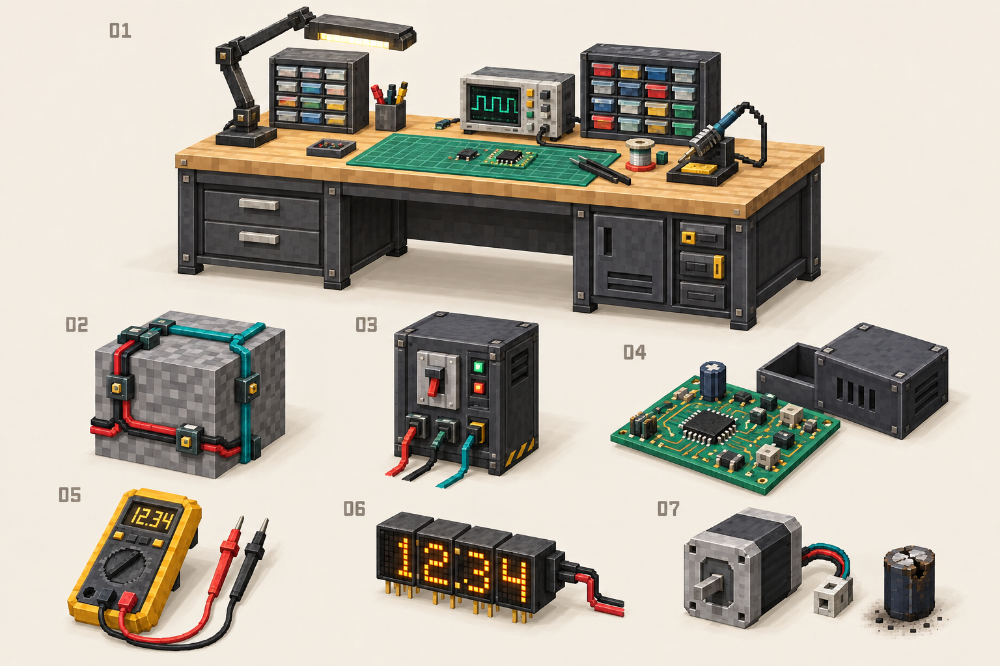
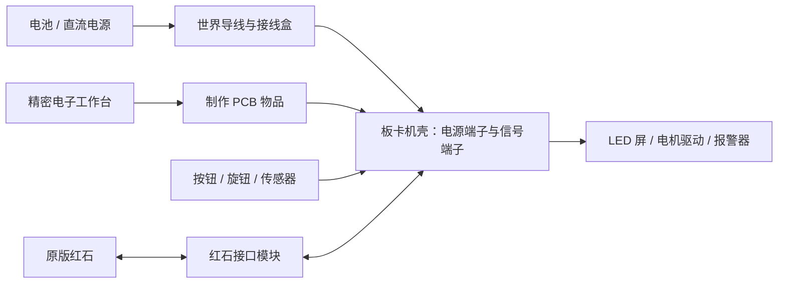

# Electron: Circuit Foundry — 模组设计稿 v1.1

**平台：Minecraft 1.21.1 / Fabric / Java 21**  
**日期：2026-10-02 · 状态：供评审的设计方案，尚未实现**

> 本文保留早期概念与美术方向。完整内容、配方、E32 开发板和布线规则现以 [完整玩法设计 v2](ELECTRON_GAMEPLAY_V2.md)、[内容与合成表](ELECTRON_CONTENT_RECIPES_V2.md)、[同格多线与穿墙连接](ELECTRON_WIRING_V2.md) 为准。

> 从接亮一颗 LED，到焊出一块控制板，再到用自己搭建的计算机控制工厂。

本稿建议将 Electron 扩展为一个以电路设计、制造、测量和维修为核心的电子工程模组。世界内的大型线路负责连接电源、设备和机械；精密电子工作台负责设计微型电路，制作可装入设备的 PCB。两个尺度使用一致的端口与电学规则。

现有工程为 `0.2.0-alpha.4`。已经实现红石逻辑门、二进制存储器、EA-8 汇编器，以及纯原版方块的十进制计算器生成器。默认计算器已在原算术蓝图上增加数字按钮操作台、原版输入与执行控制电路、大型立式灯屏，操作规范与验收状态见 [计算器操作平台 v2](CALCULATOR_CONSOLE_V2.md) 和项目 README。展示名为 **Electron: Circuit Foundry**。本文中的电线、电学仿真、PCB、仪表、微控制器、损坏系统和新美术仍属于后续设计。



图中：01 精密电子工作台；02 表面导线与接点；03 电源柜；04 PCB 与机壳；05 万用表；06 数字显示模块；07 电机与损坏电容。图片由内置 image_gen 生成，用于讨论原创模型与贴图方向，非游戏实机截图。图中的读数、接线与器件比例不作为电气或尺寸规格；具体规则以本文为准。[完整生成提示词](ART_CONCEPT_PROMPT.txt)

## 1. 总体取舍与命名

### 推荐的核心取舍

| 问题 | 本稿建议 |
| --- | --- |
| 新线路还用红石粉吗？ | 新电子系统使用 Electron 自有导线；通过专用接口连接原版红石。 |
| 旧计算器怎么办？ | 保留纯原版生成模式，继续履行“生成物只能使用原版”的要求。 |
| 大型线路和微型线路如何区分？ | 前者在世界中放置方块和导线；后者在工作台编辑，制成电路板物品，装入机壳运行。 |
| 是否加入电压、电流、电阻？ | 加入；先实现低压直流，再扩展小规模模拟电路、机械负载和交流供电。 |
| 是否支持烧毁和爆炸？ | 支持可诊断、可保护、可维修的器件故障；默认损坏限制在器件和板卡内。 |
| 是否加入 STM32？ | 提供原创 E32 游戏开发板及模板，模拟开发板使用流程；用户已明确不要求真实 STM32 兼容，兼容不列入开发目标。 |
| 是否要独立模型和贴图？ | 要；工作台、仪表、电源、电机、插座、导线、板卡和主要元件各有独立外观。 |
| 第一版做多少？ | 先完成“电源—导线—电阻—LED—万用表—保险丝”闭环，再扩展。 |

### 已确定名称

用户选择的正式展示名为 **Electron: Circuit Foundry**。中文说明可以使用“电路工坊”，发布标题以英文名称为准。

继续使用 `electron` Mod ID、`top.lacrus.zephyrzeno.electron` Java 包名，以及现有 `/electron` 指令。展示名称已写入 `fabric.mod.json`。若未来确实更换资源命名空间，应另做存档迁移方案。

## 2. 两个尺度，一套连接规则

### 世界尺度：配电与设备

玩家可以沿方块表面铺线、装插座、布置控制柜，把电源、传感器、显示器、电机和执行机构连接起来。单根线条在一个方块中清晰可见，保留 Minecraft 搭建的直观感。

这一层解决“电从哪里来、信号送到哪里、设备如何工作”。接线盒、排线、穿墙端子和线槽减少线路占地，彩色套管与标签说明线路用途。

### 工作台尺度：元件与板卡

精密电子工作台提供放大的编辑平面。电阻、电容、芯片等位于板内格点中，不占世界中的完整方块。成品 PCB 是有设计、元件和运行状态的物品，装入板卡机壳后，对外暴露接线端子。

PCB 同时承载实际连接表和元件参数。把已有设计封装成模块后，仍然可以打开查看内部电路与探测信号。教学用门电路 CPU 必须保留门、寄存器、总线和时钟结构。



### 三条计算路径必须明确标注

| 路径 | 运算由什么完成 | 用途 |
| --- | --- | --- |
| 原版红石电路 | 世界中的原版红石门、连线与存储 | 延续现有生成器和“完全用原版红石”目标。 |
| Electron 元件电路 | 模组仿真器执行实际元件连接表与时序 | 密集逻辑板、模拟电路、结构可观察的 CPU。 |
| E32 固件控制器 | 虚拟指令机执行玩家固件，外设与电路交互 | 自动控制、屏幕界面、传感器采集。 |

菜单、蓝图和物品说明显示当前路径。不能将固件算出的结果包装成“由玩家搭建的门电路完成”。一块 PCB 的物理尺寸缩小，也不代表它变成了纯原版红石结构。

## 3. 大型线路：自己的电线应该怎样好用

### 导线与连接件

| 物品 / 方块 | 作用 | 推荐阶段 |
| --- | --- | --- |
| 绝缘铜导线 | 低压电源与模拟连接，有电阻和载流上限 | P1 |
| 电源双芯线 | 一次铺设正、负两根独立导体，端子可展开 | P1 |
| 接线端子、接线盒 | 明确分支、测量、拆接，显示网络标签 | P1 |
| 开关、按钮、保险丝座 | 手动控制和基础保护 | P1 |
| 信号导线 | 适合 GPIO 和低电流逻辑信号，不承载电机负载 | P2 |
| 8 / 16 芯排线、总线插座 | 每芯仍是独立信号，按位命名与探测 | P3 |
| 交叉桥、穿墙端子、线槽 | 跨线、过墙、隐藏整理 | P3 |
| 大电流电缆、断路器 | 电机和配电柜使用，更低电阻、更高材料成本 | P5 |
| 继电器、隔离接口、电平转换器 | 开关负载、隔离网络、转换逻辑电压 | P3–P5 |

P1–P5 的阶段含义见第 14 节。

### 放置体验

- 线轴点选起点，拖出路径预览，再确认终点；预览显示长度、材料数、连接对象和可能的交叉。
- 基础交付即包含同格多根独立导线、两层绝缘跨线和六面穿墙端口，具体容量、交互及连接规则以 [布线 v2](ELECTRON_WIRING_V2.md) 为准。
- 线碰到经过的另一根线，**只有通过接点或显式合并才导通**。交叉桥的形状直接表达绝缘跨越。
- 接线盒有可点击的端子；螺丝刀切换连接，剪线钳移除选中段，标签笔编辑网络名称。
- 放置预览显示前、后、输入、输出；箭头与玩家视线一致，扳手旋转时同步预览端口。沿用目前修正后的方向习惯。
- 破坏支撑方块后的掉落、可保留线槽的悬空条件、液体影响均有明确规则；第一版不额外模拟潮湿漏电。

### 颜色分成两种用途

导线套管颜色是玩家标签，**不决定电气连通性**。逻辑上相连的两个端子即使不同色，仍会导通。不同色的裸露连接点也不能自动绝缘。

| 建议标签 | 颜色 / 形状 | 说明 |
| --- | --- | --- |
| 直流正极 / 回流 | 红 / 黑；另有 `+` / `−` | 依靠极性符号和接线确认，不靠颜色判定。 |
| 数据信号 | 青色、单箭头或双箭头 | 显示端口方向与电压域。 |
| 时钟 / 控制 | 黄色 / 灰色；CLK / EN | 有脉冲指示和网络名。 |
| 存储模块 | 紫色边框，地址图标 | 模块分组，不等于导线电压。 |
| 输入 / 输出模块 | 黄绿色 / 白色边框 | 延续当前计算器的视觉习惯。 |

原版蓝图继续使用现有功能羊毛配色。新的 PCB 用分组底色、网络高亮和标签表达功能；铜箔本身保持铜色。色觉辅助模式增加纹理、符号与文字。

## 4. 精密电子工作台与 PCB

### 工作台形态

建议为 **2 格宽 × 1 格深 × 1 格高** 的主体，顶部小型仪器纳入模型轮廓。放置时校验两格占位。一个主方块实体管理库存与设计；副格只负责交互映射和整体拆除，避免重复掉落。

基础工作台包含元件托盘、板卡夹具、放大灯、焊接区和小测试电源。后续可以安装示波器、双面布线、自动布线和自动装配附件。

### 制作流程

1. **设计原理图**：拖放元件，选择阻值、容量与额定值，给端口命名；元件库直接显示中文说明和引脚图。
2. **电气检查 ERC**：发现悬空供电脚、输出冲突、电压域不匹配、无回流路径等问题。
3. **试验运行**：在工作台沙盒中添加电源和探针，测量节点、单步时钟、记录波形；不消耗实际元件。
4. **PCB 布局**：安排封装、铜箔与过孔，检查走线宽度、间距和网络连接。基础板单面，高级板双面。
5. **制作空板**：按板面积、层数和铜用量消耗覆铜板与加工耗材；首版使用工作台加工流程，后续再独立蚀刻机或铣板机。
6. **装配与焊接**：投入对应元件，在焊盘完成焊点。批量装配使用已验证的模板与装配附件。
7. **通电验收**：先限流供电，查看功耗、输出和错误；保存带版本的测试记录。
8. **封装安装**：放入机壳，选择外部端子的对应引脚，连接世界线路。

ERC 和 DRC 的定位参考 KiCad：前者检查电气连接规则，后者检查 PCB 布局规则；通过检查仍需要功能测试。[KiCad 官方入门文档](https://docs.kicad.org/8.0/en/getting_started_in_kicad/getting_started_in_kicad.html)

### 界面草图

```text
┌ 精密电子工作台 · 板卡「四则运算控制板」 · 修改未保存 ───────────┐
│ 原理图   PCB   仿真与测量   装配与焊接   测试记录               │
├─────────┬──────────────────────────────┬───────────────────┤
│ 元件库   │                              │ 所选元件：R3      │
│ 搜索     │      电路 / 板卡主画布       │ 阻值：330 Ω       │
│ 基础元件 │                              │ 功率：0.25 W      │
│ 逻辑与存储│     节点标签、端口箭头       │ 当前：9.1 mA      │
│ 仪表探针 │     按网络高亮与局部放大     │ 耗散：27.3 mW     │
├─────────┴──────────────────────────────┴───────────────────┤
│ 运行 / 暂停 / 单步   探针：TP1 对 GND = 5.00 V   模拟时间     │
│ 检查：0 错误 · 1 警告：U2 的 EN 引脚悬空                    │
└───────────────────────────────────────────────────────────┘
```

低分辨率窗口将属性面板收起为抽屉；线宽、文字和引脚命中区域可缩放。工具有中文提示、快捷键提示、撤销与重做，布局编辑不要求逐像素点击。

### 尺寸与封装草案

| 板卡 | 编辑格点 | 用途 |
| --- | --- | --- |
| 基础板 | 16×16，单面 | LED、小电源、简单逻辑与传感器。 |
| 标准板 | 32×32，双面 | 显示驱动、寄存器、控制器。 |
| 扩展板 | 64×64，双面或子板插槽 | CPU 子模块与复杂设备，放在性能验收以后。 |

格点是游戏内制作单位，不声称等同实际毫米。器件封装按引脚和用途占据合理面积；不能把整个 CPU 当成一个无成本的自定义黑盒元件。标准逻辑 IC 可以提供明确的功能封装，但端口、供电和延迟必须可见。

### 焊接玩法

第一版采用可预测的操作：放置元件 → 加热焊盘 → 加锡 → 松开 → 检查。锡量和加热区间有清晰反馈，不采用随机“合成失败”。

- 少焊或未连接：焊点呈哑色，对应开路或较高接触电阻。
- 连锡：相邻焊盘出现可见锡桥，产生真实短路；吸锡带可以修复。
- 极性错误：装配时给提示，玩家仍可在试验模式中验证后果。
- 熟悉流程后可保存装配模板，按材料自动装配，不要求每块量产 PCB 都重复焊数百个焊点。

默认模式不因几秒钟操作失误永久烧坏焊盘；高级维修难度再加入焊盘脱落和飞线补救。

## 5. 器件库：按用途扩展

| 类别 | 推荐器件 | 核心玩法 |
| --- | --- | --- |
| 无源元件 | 电阻、电位器、陶瓷电容、电解电容、电感 | 限流、分压、RC 延时、滤波与储能。 |
| 半导体 | 二极管、LED、齐纳管、NPN、MOSFET | 单向导通、稳压、开关与电机驱动。 |
| 模拟接口 | 比较器、施密特触发器、基础运放 | 阈值检测、去抖、传感器放大。 |
| 数字逻辑 | 现有八种门的电气版本、三态缓冲、复用器、译码器 | 构建组合逻辑与总线。 |
| 时序与存储 | D 触发器、锁存器、计数器、移位寄存器、SRAM、ROM | 时序控制、数据保存、程序存储。 |
| 时钟 | 手动单步器、可调振荡器、分频器 | 观察信号传播与控制 CPU。 |
| 供电 | 电池、限流电源、稳压模块、整流模块、保险丝、断路器 | 不同电压域与负载保护。 |
| 输入 | 按键、拨码开关、旋钮、十进制编码盘、键盘 | 手动输入与操作台。 |
| 传感器 | 光敏、温度、压力 / 接近、转速 | 与 Minecraft 世界交互。 |
| 输出 | 单颗 LED、蜂鸣器、七段数码管、点阵屏、继电器 | 显示、报警、控制。 |
| 控制与计算 | EA-8 模块、E32 开发板、下载器 | 电路计算机与固件控制器两条路线。 |
| 机械 | 直流电机、伺服模块、步进电机与驱动器 | 风扇、门、定位台、机械负载。 |
| 调试 | 万用表、示波器、逻辑分析仪、探针、测试夹具 | 定位电气、逻辑和时序故障。 |

不把所有器件塞进首版。尤其电感、运放、交流、伺服与真实总线外设，应在基础求解器稳定后逐项加入。

初期元件数值采用少量标准档：电阻 100 Ω、330 Ω、1 kΩ、10 kΩ；电容 10 μF、100 μF、1000 μF；电源 3.3 V、5 V、12 V。工作台高级模式再开放自定义参数。这些是**游戏内容与平衡草案**，并非已经验证的模组参数。

## 6. 电压、电流、电阻：真实性边界

### 玩家可理解的规则

1. **电压属于两个节点之间的差值。** 测量必须说明参考点；“GND”是明确连接的参考网络，不是所有机器自动共享的回流通道。
2. **电流由电路与负载共同决定。** “5 V / 2 A”电源表示电压目标和限流能力，并不会强行向每个元件灌入 2 A。
3. **形成回路才有持续负载电流。** 双芯线只是方便同时铺设往返两根导体，不能取消回流线的意义。
4. **普通线有损耗。** 长度和截面影响电阻，电流引起压降和发热；短而粗的线更适合电机。
5. **电容有历史状态。** 充放电由连接和时间决定，断开电源后可以暂时保留能量。
6. **供电影响数字电路。** 欠压、悬空、争用、上电复位和输出负载都有明确行为。

基础关系采用 `V = I·R`、`P = V·I`、电阻耗散 `P = I²R`、电容能量 `E = ½CV²`。热模型将耗散、环境温度和散热能力联系起来。

举例：在**教学用 LED 固定压降模型**中，5 V 电源、2 V 正向压降 LED 与 330 Ω 电阻串联，电流约为 `(5−2)/330 = 9.09 mA`，电阻耗散约 27.3 mW。仪表、亮度和热量应从同一求解结果导出。真实元件模型更复杂，游戏不能把此例当作所有 LED 的固定特性。

### 四类求解任务

| 类型 | 推荐方法 | 模拟边界 |
| --- | --- | --- |
| 大型供电网络 | 节点网络求解，合并不分支线段为等效电阻，保留测量映射 | 算压降、电流和损耗；不逐粒子模拟电子。 |
| 数字逻辑 | 有明确传播延迟的事件队列 | 门电路、寄存器、总线，只有变化时调度。 |
| 小型模拟电路 | 节点电压 / 支路方程，电容离散积分，有限迭代的分段非线性模型 | 低频 RC、LED、二极管、开关等逐步加入。 |
| 固件控制器 | 有预算的虚拟指令机，加外设事件 | GPIO、定时器、ADC、串行接口；显示实际模拟速度。 |

数字事件与模拟电路协同是一种已有的仿真思路，例如 ngspice 的混合信号系统使用事件驱动的数字部分。[ngspice 官方说明](https://ngspice.sourceforge.io/extras.html) 本方案借鉴分工方式，并不表示已集成 ngspice，也不承诺 SPICE 模型兼容。

### 模拟边界与时间

- 服务器维护统一的电路模拟时间和确定性的事件顺序。MC 的一个游戏刻内可以处理有限的内部子步骤，不把每次逻辑变化都变成方块更新。
- 第一版不承诺 MHz 级逐门实时仿真。工作台显示实际可用的时钟上限、耗时和模拟时间比例；超预算时明确减慢或暂停该网络。
- 模拟网络求解失败时显示具体网络、最近稳定状态及“无有效解 / 未收敛”。不能把失败默认为 0 V，或沿用旧值却显示正常。
- 短路通过线阻、源内阻、限流和保护器件求解；矛盾的理想电源连接需要报告错误。浮空网络可以选定内部数学参考点，但不能凭空接通回路。
- 数字信号支持 `0 / 1 / Z / X`：高阻、悬空和输出冲突应可观察。转换阈值由器件电压域决定，阈值附近用迟滞避免抖动。
- 数字 IC 使用受控的端口电气模型和功耗模型，不逐个模拟内部晶体管；门级结构、延迟与存储语义仍保持可观察。
- 初期不模拟无线电、射频、精细电磁场、完整半导体工艺或电网相位并机。

## 7. 仪表与调试：让故障有办法查

| 工具 | 交互 | 能回答的问题 |
| --- | --- | --- |
| 万用表：电压档 | 两支表笔连接两个节点 | 电源是否正常、哪里有压降、极性是否接反。 |
| 万用表：电流档 | 在线路中串入测试端子或分流器 | 实际负载多大，哪个支路过流。 |
| 万用表：电阻 / 通断档 | 断电后施加小测试激励；带电时显示“请断电” | 线路是否断开、焊点是否连锡。 |
| 逻辑探针 | 连接单个数字脚，可显示脉冲历史 | 是高、低、浮空，还是有短脉冲。 |
| 双通道示波器 | 两路差分探头、时间尺度、触发条件 | RC 充电、PWM、时序和电源波动。 |
| 逻辑分析仪 | 多通道记录与触发 | 总线位序、寄存器采样和 CPU 执行阶段。 |
| 热探头 / 检修镜 | 查看器件温度和额定值 | 哪个器件过载、散热是否足够。 |
| 测试夹具 | 保存输入序列和预期输出 | 做回归测试，量产前检查板卡。 |

万用表电流档直接跨接电源会形成低阻支路，可以触发表内保险丝；学习模式给出操作解释。PCB 上放测试点，世界设备上放检修插孔，可显著减少拆线操作。

波形来自真实仿真数据。被抽象成平均值的高频 PWM 或市电只展示占空比、有效值和模型标签；示意正弦曲线必须标为示意，不能冒充采样结果。

故障记录至少包括：器件位置、时间、供电、电流或温度、触发原因、受影响网络，以及建议测量点。普通模式优先提供线索；创造学习模式可直接高亮故障链。

## 8. 计算机与开发板

### EA-8：亲手搭出计算机

沿用现有 [EA-8 指令与硬件契约](../EA8.md)：8 位累加器与程序计数器、16 位指令、256×16 位 ROM、256×8 位 RAM，支持算术、逻辑、条件跳转、输出和停机。

下一步依次制作寄存器、ALU、程序计数器、ROM、RAM、控制器与总线。原版路线使用红石模块；Electron 路线可以使用门 IC、寄存器 IC 和 PCB，但取指、译码、写回必须由连接起来的硬件完成。单步按钮应能展示 IR、PC、A、标志位和写使能变化。

ROM 编程器将现有汇编器输出写入程序存储器；运行时不能调用汇编表达式求值器代替硬件执行。中间计算结果可以用探针观察。

### E32：类似 STM32 开发板的控制玩法

建议使用原创名称 **Electron E32 开发板**，带电源指示、复位键、下载插座、排针与明确丝印。玩家可以装入模板、编写固件、烧录、观察引脚并连接传感器。

| 首轮规格草案 | 设计 |
| --- | --- |
| 电源 | 板载稳压输入与 3.3 V 逻辑域，低压复位。 |
| GPIO | 16 个可配置引脚，输入、输出、上拉、高阻与争用检测。 |
| ADC / PWM | 4 路抽象 12 位 ADC、4 路 PWM，可与 GPIO 复用；采样率受模拟预算限制。 |
| 定时器 | 周期中断或事件回调，时间基准由虚拟系统定义。 |
| 存储 | 初拟 16 KiB 程序与 4 KiB RAM，后续按实际实现验收调整。 |
| 语言 | 定义公开的 E32 虚拟指令 / 字节码与汇编；以后再加受限高级语言。 |
| 通信 | 首先实现一组 UART；I²C、SPI 在显示与传感器需求明确后扩展。 |
| 模板 | 闪灯、按键去抖、温控风扇、四则计算器、矩阵屏、串口监视。 |

这些是游戏开发板规格，不是某款真实芯片的复刻。真实 STM32F103C8 涉及 Arm Cortex-M3、具体存储器布局、ADC、定时器和通信外设；直接运行其固件需要对应 CPU 与外设仿真，复杂度远高于一个外观相似的板卡。[ST 官方产品页](https://www.st.com/en/microcontrollers-microprocessors/stm32f103c8)

按用户明确的范围，E32 只模拟游戏开发板功能，不兼容 STM32 `.bin`、ARM 指令集或 STM32Cube 工程，也不把兼容作为后续目标。E32 的 `32` 只作为系列名，编程与引脚契约见 [完整玩法设计 v2](ELECTRON_GAMEPLAY_V2.md)。

固件不能读写宿主文件、访问网络或执行宿主命令。死循环消耗该板卡的指令预算，不能卡住服务器。GPIO 供电能力有限，电机需要驱动级。

## 9. 电源、显示屏和电机

### 电源与“市电方块”

| 电源 | 用法 | 资源约束 |
| --- | --- | --- |
| 创造测试电源 | 可调电压、限流、开关、测试波形 | 创造模式无限供能，明确标注。 |
| 可充电电池 | 便携设备、备用电源 | 有容量、内阻、最大放电电流；充电需能量输入。 |
| 实验室直流电源 | 工作台调试，稳压 / 限流反馈 | 生存模式由储能或上级供电提供能量。 |
| 发电机 | 将燃料或机械输入转为电能 | 明确效率和负载关系，耗能后才能输出。 |
| 市电接口箱 | 给工厂提供交流配电端口 | 创造版无限供电；生存版接入玩家发电站或服务器明确启用的有限公共电网。 |

“市电”可选择 **220 V / 50 Hz 的游戏预设**，但应放在后期。普通运行使用有效值与功率模型，整流、变压、稳压模块使用明确的行为模型。不能用每游戏刻一次采样来声称精确重建交流波形。

第一版先把 3.3 / 5 / 12 V 直流做完整。市电柜与低压控制板之间需要电源模块；不能把高压线接到 GPIO 后继续正常工作。与其他能源模组的转换后续通过适配器实现，公开换算与效率，不默认为免费电源。

### 显示设备

1. 单颗 LED 和 LED 指示排：最小可用输出，亮度与电流关联。
2. 七段数码管模块：直接段引脚与带驱动接口两种型号，适合现有计算器。
3. 8×8 单色点阵：支持直连扫描，玩家能学习行列驱动；也提供带显存的驱动板。
4. 可拼接 LED 屏：首个整屏建议 32×16 或 64×32，接口、刷新频率和功耗明确；再扩展 RGB。

带驱动模块的屏幕公开显存格式与通信协议。写满缓冲区不会自动意味着无限刷新率。显示内容可以是数字、图形、菜单和 CPU 调试页，默认不是网页浏览器。

### 机械负载

直流电机先实现转速、负载转矩、电流和发热的简化关系。堵转导致高电流；增加负载会影响转速。玩家通过 MOSFET 驱动、续流保护和 PWM 实现调速。

首批用途建议是散热风扇、电动门和转台。步进电机、伺服模块与更复杂的轴系统后续扩展。机械输出消耗电能；把电机接回发电机不能产生净能量。与 Create 的连接可以作为独立兼容模块，当前不设为前置依赖。

## 10. 器件损坏与维修

目标是让错误有可观察的过程：**接错或超载 → 仪表出现异常 → 保护动作或升温 → 损坏 → 定位和修复**。正常额定工作不加入随机自然老化倒计时。

| 故障对象 | 条件与表现 | 修复 / 保护 |
| --- | --- | --- |
| 电阻 | 持续耗散超过散热能力，变色、冒烟，最终开路 | 换大功率型号或调整阻值与电路。 |
| 电解电容 | 反接、超额定电压或过热，漏电增加、鼓包，最终泄压或失效 | 检查极性、选耐压、稳压、替换电容。 |
| LED | 电流超限，过热后暗掉或开路 | 串联限流电阻、恒流驱动。 |
| 芯片 / GPIO | 电源或输入超限、输出争用、驱动负载过大 | 稳压、电平转换、串阻、驱动级与保险丝。 |
| 导线 / 铜箔 | 过流发热、绝缘变色，最终断路 | 加粗导线、拆分支路、加保护。 |
| 电机 | 堵转或持续过载，温升和电流异常 | 限流、降低负载、散热与停机保护。 |
| 保险丝 | 累积过流达到模型阈值，熔断 | 排除短路后更换；断路器可复位。 |
| 焊点 | 漏焊、冷焊、连锡 | 补焊、吸锡、重装；仪表验证。 |

现实电解电容的反向或异常电压可能引起漏电、发热、产气和内部压力上升，这为鼓包与泄压提供了合理的表现依据。[Nippon Chemi-Con 技术说明](https://www.chemi-con.co.jp/en/faq/detail.php?id=alLifetime) 游戏内损坏时间与阈值需要单独平衡，不复制为真实器件的通用数值。

“电容爆炸”建议表现为短促爆音、顶盖破裂、烟雾和坏件。损坏效果根据元件类型、储能与外部供电应力决定；小电容不应都有 TNT 级威力。

### 三种运行设置

| 模式 | 后果 | 适合场景 |
| --- | --- | --- |
| 学习 / 创造 | 给出电气故障和演示效果，可复位恢复，不永久消耗元件 | 学电路、开发、课堂。 |
| 标准生存（推荐默认） | 熔断、烧毁、鼓包与板内损伤；默认不炸地形、不引燃建筑 | 日常生存与多人服务器。 |
| 严格工程 | 可开启邻近器件连带损伤、着火与有限范围爆裂 | 玩家主动选择的挑战。 |

服务器统一配置故障后果；领地和方块破坏规则仍须遵守。纯原版蓝图继续遵循原版行为，学习模式的保护只覆盖 Electron 仿真对象。

热量、能量与故障状态共同持久化。区块卸载、重新加载和装卸板卡不能反复重置过载状态来复制能量或规避故障。拆卸板卡通过放电流程处理储能，动态残余能量不进入可堆叠的普通物品。

设计模板可以复制；实体板卡和带电池的设备分别保存实例状态，不能通过复制蓝图复制充电量。断电后的 SRAM / 寄存器按器件定义丢失数据或进入未定义状态，ROM / 非易失存储保留数据；保存游戏和断电必须区分。电容短时维持供电时，应继续按实际电压判断保持或复位。

## 11. 美术方向与独立资产

### 整体风格

采用 **Minecraft 像素工业风 + 实验室工作台细节**：石墨灰外壳、木质台面、绿色 PCB、铜色端子，少量黄色提示和青色信号灯。轮廓用方体组织，细节主要放进像素贴图，发光只用于实际亮起的灯与屏幕。

不将整套元件做成“同一个方块换颜色”。通过轮廓就能区分电源柜、仪表、机壳、工作台和电机；通过引脚布局与丝印区分元件方向。

### 资产清单与制作方式

| 资产 | 独立建模重点 | 贴图与状态 |
| --- | --- | --- |
| 精密电子工作台 | 两格台面、夹具、抽屉、灯、焊台 | 木、金属、网格垫；工作 / 空闲。 |
| 电源柜与实验电源 | 开关、端子、散热口、读数面板 | 通电、限流、跳闸；端子极性可读。 |
| 导线与接线盒 | 直线、转角、分支、跨线、端子 | 套管色、铜接点、过热变色。 |
| PCB 与控制板 | 基板、铜箔、封装、排针、机壳 | 原创丝印、网络标签、损坏位置。 |
| 万用表 / 焊枪 / 探针 | 手持轮廓、双探头、档位、笔尖 | 普通物品与使用中姿态。 |
| 电机 | 方形外壳、轴、支架、端子 | 转动、温升、损坏。 |
| 显示器 | 面板边框、背部接口 | 动态像素单独渲染，不大量创建世界灯块。 |
| 电阻、电容、芯片 | 封装和引脚朝向，板内近景可辨认 | 正常、过热、烧焦、鼓包等必要变体。 |

源文件建议保留 Blockbench `.bbmodel` 与分层贴图工程，发布使用 Minecraft 可用的模型与 PNG 贴图。普通模型优先原生方块 / 物品 JSON；线网、板卡布局和屏幕按需要使用少量专用渲染。

单方块以 16×16 或 32×32 像素密度统一风格，多格工作台可使用共享图集。不能给每块 PCB 建一个方块实体或每个元件单独发一个网络包。板卡远处使用缓存外观，近处或打开检修盖后显示较完整的元件布局。

概念图用于讨论视觉方向；它不是已经制作完成的模型、贴图或游戏截图。最终资产必须按碰撞体、朝向、贴图映射、手持显示和状态变化重新制作与验收。

## 12. 从入门到计算器：建议的教程和模板

| 顺序 | 玩家作品 | 学到的内容 |
| --- | --- | --- |
| 1 | 电源、电阻和 LED | 回路、极性、限流、万用表。 |
| 2 | 电位器调光与按钮报警器 | 分压、负载、输入输出。 |
| 3 | RC 延时灯 | 充放电、阈值和时间响应。 |
| 4 | 带保险丝的风扇控制板 | 驱动级、负载、过流和散热。 |
| 5 | 半加器、全加器、寄存器 | 组合逻辑、进位、存储。 |
| 6 | 双位十进制计算器 | 进制转换、四则运算、锁存、数码显示。 |
| 7 | EA-8 单步计算机 | 程序存储、取指、执行、汇编。 |
| 8 | E32 温控与屏幕终端 | 固件、采样、PWM 与通信。 |

### 计算器的新模板

用户确定将生成计算器改为**数字键操作平台 + 大型立式显示屏**。数字 `0–9`、运算符 `+ − × ÷` 和运行键 `=` 都使用按钮，告示牌标识数字和中文功能。每次按数字按钮追加一位，按顺序输入 `甲数 → 运算符 → 乙数 → =`，例如 `1 → + → 1 → =`。每个操作数范围仍为 0–99。

输入区位于屏幕前方，显示区竖直安装在有边框和厚度的机架中。屏幕上部显示当前表达式，下部显示计算结果，另有输入就绪、运算中与错误状态。新方案不再要求玩家手动拨 BCD 拉杆，也不再手动切换“保持结果”；按钮编码、输入保存、启动与结果锁存由电路完成。[完整操作、状态和原版硬件规范](CALCULATOR_CONSOLE_V2.md)

电路分为：输入（黄绿色）、控制（灰）、进制转换（青）、加法（橙）、减法（红）、乘法（黄）、除法（蓝）、存储（紫）、显示（白）。每个模块可展开，连线可按来源网络高亮。

保留当前计算器规则：最大乘积 9801；减法带负号；除法四舍五入到两位小数；除零单独报错。示例 `12 ÷ 5 = 2.40`、`1 ÷ 6 = 0.17`。除法结果以放大 100 倍的整数和小数点标记保存，屏幕四个数位外另设负号和错误指示。十进制显示与二进制探针读取同一寄存器。

建议提供两个新增模板：

- **门电路计算板**：加减乘除与显示转换均由门、寄存器和可观察的连线组成，适合用户最初的计算机原理目标。
- **E32 计算器示例**：固件完成运算，板外电路处理输入、显示、供电，适合学习嵌入式控制。

这两个模板与现有的**纯原版计算器蓝图**并列展示。当前 `/electron calculator ...` 的原版含义保持不变；未来新增入口要显式选择后端和材料清单。

## 13. 软件结构、蓝图和性能

### 建议的软件职责

```text
top.lacrus.zephyrzeno.electron
├─ BluePrint        保留用户指定名称：设计读写、生成、布局、检查、放置
│  ├─ vanilla       原版结构后端（未来内部整理）
│  └─ pcb           PCB 布局与装配蓝图（未来新增）
├─ electrical       网络、端口、元件模型、数字事件、模拟求解
├─ component        导线、元件、封装与额定参数
├─ pcb              板卡物品、设计版本、实例状态、机壳
├─ instrument       探针、仪表、测量记录
├─ controller       E32 虚拟机和外设；与 EA-8 结构执行明确分开
├─ machine          电源、工作台、制造与机械设备
├─ fault            热状态、保护动作、损坏与维修
└─ client           编辑界面、模型、屏幕、局部网络可视化
```

这是职责建议，不是此次已完成的包调整。现有 `BluePrint` 包及原版生成器保持可构建。

蓝图记录**设计**，实例记录**运行状态**。板卡设计包含元件、参数、引脚、连接、布局和版本；实例另存寄存器、RAM、固件状态、温度和故障。分享设计不自动分享世界坐标和玩家信息。

原理图与 PCB 布局必须核对网络一致性。自动布线产生可检查的走线和成本，出现未连接节点就不能标记为完成。不同后端并非所有器件都能互相转换：模拟电容不能自动导出成原版红石电容，E32 程序不能自动导出成纯门电路 CPU。

导入只接收受限的数据格式，不运行脚本；校验版本、体积、元件数、网络数和参数范围。多人编辑使用版本校验与锁定 / 合并机制，服务器确认库存扣除、焊接和设计更新。

### 性能原则

- 仅在连接关系改变时更新拓扑。普通直线段压缩为等效连接，保留测量、发热和故障位置映射。
- 按互不连接的网络分开求解，稳定数字网络休眠；运行中的时钟和模拟储能元件仍按需推进。
- 一块板卡共用调度和状态容器，不为每个板内元件创建世界方块实体。
- 客户端主要接收显示变化、用户当前打开的仪表数据和必要的状态差量。
- 整个连接网络采用一致的暂停边界；遇到未加载端点，明确显示“网络暂停”，不把卸载区块误当成导线断开。第一版不暗中强制加载区块，也不补算离线电能。
- 触及事件、迭代或规模上限时显示原因和受影响网络，并暂停或减速。不能悄悄丢弃脉冲，或降低精度后仍声称读数准确。

**待压测的起始工程目标**：一块基础板约 128 个简单元件；一个模拟连通分量约 64 个待求节点；一个数字网络约 4096 个简单门。每服务器 tick 的电路总耗时以 2 ms 作为初始目标。这些是研发预算草案，不是当前测量结果，也不保证任意电路都能达到；非线性元件、振荡与多玩家负载需单独评估。

当前原版计算器有 677,866 个原版方块，另加中文告示牌，见 [README](../../README.md)。新架构可以减少世界方块数量，但不能据此承诺门电路、模拟电路或 MCU 的速度；三类系统都需要独立基准。

## 14. 分阶段实现与验收

不先指定日期；每阶段在前一阶段有证据后推进。优先完成可以完整体验的玩法，而不是一次注册大量只有外观的器件。

| 阶段 | 完成的体验 | 必须验收的结果 |
| --- | --- | --- |
| P1：直流入门 | 自有导线、端子、电源、电阻、LED、开关、保险丝、万用表及原创模型 | 串并联电流与压降正确；断线停止供电；限流与熔断可解释；保存加载一致。 |
| P2：模拟与故障 | 电容、电位器、基础二极管、RC、示波器、热量和维修 | RC 时间响应与容差明确；反接 / 过压有一致过程；不收敛可诊断。 |
| P3：工作台与 PCB | 原理图、ERC、布局、DRC、焊接、板卡机壳、模板与总线 | 板内外等价连接产生相符结果；布局不偷接线；物料、复制、导入和多人编辑可验证。 |
| P4：计算与显示 | 寄存器、存储、七段 / 点阵屏、门电路计算器与 EA-8 子模块 | 四则模板含除零、负数、小数边界；EA-8 逐步状态可观察；没有隐藏代算。 |
| P5：控制与动力 | E32、基础通信、传感器、电机驱动、配电与后期交流 | 固件预算隔离；电机堵转和保护正确；能量收支、区块暂停与多人性能通过测试。 |

P1 的第一条完整教学任务应是：从物品栏拿出电源、线、电阻、LED 和万用表，连接回路，读出电压电流，主动制造一次受控短路，更换保险丝并修复。它同时验证电路规则、工具、模型、交互与故障反馈。

### 共用验收案例

- 同一电阻网络在不同铺线形状下产生与长度、截面一致的结果；拆线、换向、跨线、穿墙均验证连接。
- 给定元件模型下，LED 串阻读数与手算一致；电源进入限流时电压下降，不能同时维持不可能的输出。
- RC 电路对比解析解，覆盖不同步长、暂停 / 恢复和时间尺度；记录误差阈值。
- 两个推挽输出互相冲突、输入悬空、欠压与掉电复位，逻辑探针必须显示正确状态。
- 仪表不会凭空提供无限电流；电流档错误接法与表内保护相互一致。
- 过载故障可重复；修复前断电不会自动抹去烧毁状态，卸载区块不会复制电池能量。
- 电路保存 / 加载、板卡复制和多人同时操作，不复制物品，不混淆设计与运行状态。
- 基础 E32 死循环、非法指令与超预算程序，只影响对应板卡；不能阻塞服务器主线程。
- 原版蓝图导出始终检查 `minecraft` 命名空间，并保留现有完整电路验证流程。
- 远景、近景、不同朝向、透明线槽、损坏贴图和显示屏更新分别验证视觉与性能。

## 15. 本稿推荐的最终方向

使用已确定的 **Electron: Circuit Foundry** 展示名。用自己的导线建立可信的低压电学系统；用工作台与 PCB 实现密集电路；用仪表和可维修故障形成完整玩法；用门电路计算机与固件开发板覆盖两种不同的创造需求。生成计算器采用数字按钮操作台与大型立式灯屏设计。

优先交付一个小而完整的电路实验环境，再增加制作链与计算机系统。原版蓝图继续作为独立的红石工程路线，既保留已有成果，也保留最初“世界里的电路真的在计算”的目标。
