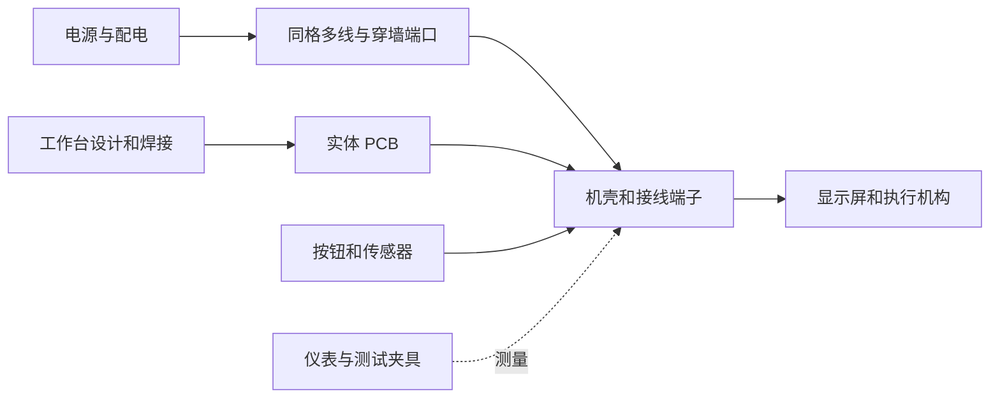

# Electron: Circuit Foundry 完整玩法设计 v2

> 分类与实施顺序已由 [三层电路设计 v3](ELECTRON_THREE_SCALES_V3.md) 更新：大型配电、小型方块器件、PCB 配件分开。本文保留目标玩法和配方参考，冲突以 v3 为准。

日期：2026-10-02。状态：**拟实施的完整目标版设计，不是当前 JAR 的功能说明**。本稿更新旧版设计中的内容范围、布线和开发板方案；数值、配方和容量均为游戏平衡初案，需在实现后测试调整。

Electron 的主要玩法是：**搭建电路，测量运行结果，找出问题，制成板卡，再让板卡控制世界中的设备。** 世界线路与微型 PCB 共用电压、电流、端口和故障规则。玩家可以只做实用自动化，也可以逐个逻辑门搭出计算机。

完整规格分为三个文档：

- 本文：玩法、阶段流程、电学、PCB、开发板、自动化、故障和美术。
- [方块物品与合成表](ELECTRON_CONTENT_RECIPES_V2.md)：完整目标版的内容范围、用途、材料和加工规则。
- [同格多线与穿墙连接](ELECTRON_WIRING_V2.md)：世界导线的容量、交互、连接和破坏规则。

当前主线 `0.3.0-alpha.1` 已实现首批直流电学、表面多线、两层布线、双芯穿墙端口、万用表、两套逻辑门及手工装配台；实际配方与边界见 [主线 README](../../README.md)。PCB、E32、电容、电机及目标版其他系统仍待实现。原版计算器已拆成独立 `electron_calculator` 模组，见 [独立说明](../../calculator/README.md)，主线不能引用或调用它。

## 1 游戏定位与范围

正式名称为 **Electron: Circuit Foundry**，中文说明为“电路工坊”。主线使用 `electron` Mod ID 和 `top.lacrus.zephyrzeno.electron` 包。原版结构生成器的 `BluePrint` 包只存在于独立工程 `calculator/`，完整包名为 `top.lacrus.zephyrzeno.electroncalculator.BluePrint`。

| 设计问题 | 本版方案 |
| --- | --- |
| 大型线路 | 自有细电线、端子、排线、线槽与配电柜；同一方块格可容纳多根互不相连的导体。 |
| 微型电路 | 工作台设计 PCB，在板内布置器件与铜箔；成品插入机壳、开发板底座或控制柜。 |
| 穿墙 | 在普通实心方块的任意一面装穿墙芯，默认生成该面与对面的成对端口；支持多芯与显式转接。 |
| 电学 | 电压、电流、电阻、功率、储能、温度与额定值参与玩法；先交付低压直流，再扩展配电。 |
| 开发板 | 原创 E32 游戏开发板，模拟 GPIO、ADC、PWM、定时器和通信外设。**不做 STM32 或 ARM 固件兼容，也不把兼容列为后续目标。** |
| 原版红石 | 原版系统照常工作，新系统通过红石接口连接；旧门方块保持红石语义。 |
| 失误后果 | 接反、过流、过压、堵转、连锡会产生可诊断的故障，提供保护与维修手段。 |
| 学习门槛 | 有完整教程、模板和自动布线，也允许裸引脚、手动焊接和纯门电路。 |
| 内容边界 | 本稿及内容表列出的内容构成完整目标版；无线电、真实芯片兼容、晶圆厂、射频和真实化学冶金不进入本轮。 |

不增加必须重新开图才能取得的矿石。铜、铁、金、石英、红石、纸、黏液球等原版材料构成生产链；绝缘带另有蜂蜜替代配方。器件制造是游戏配方，不对应真实半导体工艺。

## 2 玩家发展流程

阶段表示内容依赖和建议顺序，不是强制经验等级。所有配方可查；教程完成会解锁笔记、配色预设和示例设计，不靠反复刷物品卡进度。

| 阶段 | 玩家设施与新能力 | 一次完整任务 | 完成后能做什么 |
| --- | --- | --- | --- |
| P0 手工入门 | 电子手册、装配台、线轴、手摇电源、基础元件 | 用两根线接通电阻与 LED，再用万用表测两端电压 | 看懂回路，制作不依赖芯片的工具和电源。 |
| P1 世界布线 | 同格多线、穿墙芯、接线盒、保险丝、电池与燃料电源 | 从墙外供电，墙内安装按钮灯；故意断开一根回线后定位问题 | 在建筑里布置可维护的灯、报警器与配电。 |
| P2 精密电子 | 电容、晶体管、示波器、精密工作台、PCB、焊接 | 制作 RC 延时灯与受控风扇板，完成检测并装入机壳 | 缩小电路，理解充放电、驱动和故障保护。 |
| P3 数字计算 | 门 IC、寄存器、SRAM、ROM、总线、数码显示、测试台 | 搭出全加器、8 位寄存器，再拼门电路计算器或 EA-8 | 制作能观察内部状态的数字系统和计算机。 |
| P4 嵌入式控制 | E32、编程器、传感器、点阵屏、通信和电机驱动 | 烧录温控程序，读取传感器，用 PWM 控制风扇并显示曲线 | 编写设备行为，制作仪表、控制面板与自动装置。 |
| P5 工厂配电 | 背板、自动装配、太阳能、机械发电、工业电源与市电柜 | 建立带备用电池、分支保护和能耗表的电子工坊 | 批量制造板卡，建设大型控制网络与发电系统。 |

第一小时的目标是“做成一件有用的设备”，而不是囤积十几种中间材料。P0 工具、万用表、手摇源和基础装配台都能使用原版工作台或手工工序做出。精密工作台所需的首块通孔板可以在手工台完成，不要求先拥有精密工作台。

### 推荐教程顺序

1. **亮起第一颗灯**：认识正负端、限流电阻和回流路径；开关打开时灯灭。
2. **一格里的四根线**：为两套灯路各铺去线和回线，交叉但不短接；单独控制各灯。
3. **把电带过墙**：安装双芯穿墙端口，给背面的灯供电；切换检修视图查看芯号。
4. **测出来再改**：读取 LED 电压、电阻压降与支路电流，比较不同阻值的亮度。
5. **第一次维修**：保险丝熔断；查找短路，断电、更换保险丝、恢复供电。
6. **让灯慢一点熄灭**：电容放电、示波器触发、施密特输入消除阈值抖动。
7. **一块自己的 PCB**：原理图、布线、物料、焊接、测试、装壳。
8. **做出运算器**：半加器到全加器；手动时钟写入寄存器；观察进位。
9. **可编程的风扇**：E32 采样温度，经驱动器调速；模拟堵转并触发保护。
10. **工坊投入生产**：保存合格板设计，批量装配，按测试结果分拣良品与返修品。

教程有“给出接法”和“只给目标”两种提示。免费预览能检查设计与信号，实体试验仍消耗电能；学习世界可直接取得器材。完成教程不奖励可循环刷取的铜、芯片或充满电池。

## 3 两个尺度与三条计算路线

世界中，电源、电机和仪表保持可以辨认的实体尺寸，电线则缩小为表面上的细线。基础元件插座可把电阻、LED、电容等直接固定到墙面或台面，提供可点击的引脚；第一颗灯不必先做完整 PCB。工作台中，玩家放大板卡，在网格里放元件和铜箔。板内外相连的网络遵循相同规则，不因跨进机壳就免费隔离、稳压或增强信号。



| 路线 | 运行方式 | 玩家可观察内容 |
| --- | --- | --- |
| 纯原版红石 | 原版世界方块运行 | 火把、中继器、粉线、锁存器、灯屏。现有生成器属于此类。 |
| Electron 电路 | 求解玩家连接的器件与数字时序 | 网络电压、门输出、时钟、寄存器、地址总线。EA-8 硬件路线属于此类。 |
| E32 开发板 | 游戏虚拟机执行玩家程序，通过引脚连接电路 | 程序行、变量、GPIO、采样、通信、供电与外部驱动。 |

设备与蓝图说明必须标明路线。复制一块全加器设计会复制其中的门与连线，不能换成隐藏的算术函数。E32 示例计算器明确使用程序运算；用户指定的原版生成计算器继续完全由原版红石计算。

## 4 电线和建筑布线

**同一格可以放很多根线，是基础系统的一部分。** 表面有 16×16 编辑格；普通线宽 1/16 格，同一面支持两层走线。按轨道间距，一个面可并排走 8 根直线；上下两层最多 16 根直线。每世界格的基础预算为 64 个独立导体通过量，六面共享。排线每芯同样计入预算，完整规则见 [布线规格](ELECTRON_WIRING_V2.md)。

放线时选起点、选终点，系统吸附端子并预览路径，默认避开已有线；玩家可以添加拐点、选表面或锁定层。颜色、网络名、通道号始终可见；交叉默认使用不同层，只有接线点或显式合并才连通。

普通绝缘线、细信号线、电源双芯线、8/16 芯排线和粗电缆用途不同。**数据排线没有免费供电芯**；需要独立铺 VCC/GND，或在插座中明确分配两芯给电源并减少可用数据芯数。世界线有长度、压降和载流上限，线槽仅保护和整理，不消除这些成本。

### 穿墙端口

拿穿墙芯点击实心方块任意一面，安装预览会显示另一面。确认后在两面各形成一个端口，内部芯一一对应，原墙方块保留。一格厚墙不需要拆墙，也不需要再到背面装第二件。

一根芯只能穿过一个墙方块。两格厚墙需要两件，安装工具可以自动计算材料并连续铺设。拐向侧面时，在已有穿墙芯上加一个侧面端口盖，通过映射页把指定芯接到侧面；不会把六个面全部短接。

1、2、8、16 芯分别面向单信号、低压电源、控制排线和宽总线。每芯电气上独立，普通芯不同时兼任高压配电；工业电源使用额定更高的双芯型号。墙被破坏后，芯和端口掉落、连接断开；不保留虚空中的隐形通路。

### 整理与检修

线槽盖可不拆线打开；配线架按端子号管理连接；标签笔给线路写中文名称。检修镜可以单独显示电源、时钟、总线或某个网络，也能隐藏外壳。颜色只是标签，另有 `+`、`−`、`CLK`、芯号和纹理帮助辨认。

电线短段的收回量存在可叠加的线轴余额中，不能每次剪断都向上取整返还一整根。剪线只作用于被选中段，破坏整格则处理该格所有附属件。支持、活塞、水浸、方块实体和领地规则见专项文档。

## 5 电学规则与时间

### 直流和回路

电压是两个节点间的差；电流由电源、负载与连接共同决定。`GND` 是网络参考与实际回线标签，不是随便插一根接地棒就能消失的电流。不同电源负端只有通过导线连接才成为同一参考；并联不同电压源可能产生反灌电流，需要保护。

电阻满足游戏模型中的 `V = I × R`，功率用 `P = V × I` 计算。电池、导线和电源均有有限内阻或限流。短路会触发限流、保护或升温，不会形成无限电流。电容保存电压和能量，电感保存电流状态；断电不等于立即清空储能。

| 游戏电压域 | 用途 | 连接约束 |
| --- | --- | --- |
| 3.3 V | E32、低压逻辑、传感器 | GPIO 默认只接受本电压域；跨域使用电平转换。 |
| 5 V | 教学逻辑、LED、通孔实验、基础显示 | 5 V 电源不能直接接 3.3 V 引脚。 |
| 12 V | 风扇、直流电机、工作台、灯具 | 通过驱动级控制；不能直接从 GPIO 供电。 |
| 48 V DC | P5 建筑干线 | 末端降压，降低长线路损耗；与工业线配套。 |
| 220 V AC 游戏预设 | P5 发电站到配电柜 | 采用有效值与平均功率模型；由明确的整流、变压和逆变模块转换。 |

### 模拟与数字

初期模拟模型覆盖电阻、电容、电感、二极管、晶体管、运放和保护电路的教学工作区间。运放输出受供电与输出限幅约束，晶体管不是零耗能的理想开关，LED 需要限流；模型卡说明简化条件。

数字状态为 `0 / 1 / Z / X`：低、高、高阻、未知或冲突。电压低于供电的 0.3 倍判低，高于 0.7 倍判高，中间区间未知；带施密特功能的器件另有滞回。高阻不是 0，悬空输入不会自动变为低。默认元件容差为标称值，挑战配置可固定生成容差，读档不重新抽签。

每游戏刻推进 50 ms 仿真时间；服务器变慢时电路随游戏时间变慢。模拟步进、数字事件和 E32 指令有独立预算。高频平均 PWM 只提供占空比、平均功率与明确的模型标记，不能伪造采样波形。

逻辑教学可选慢速时钟，仪表支持单步与保存波形。超过求解或事件预算时显示“此网络暂停”或“电路仿真减速”，不静默丢脉冲。卸载边界上的相关网络整体暂停且不补算离线发电；对玩家说明受影响范围，不偷偷强制加载区块。

## 6 电源和能量经济

统一以 J 记储能，以 W 记功率；`消耗能量 = 功率 × 仿真秒数`。数值是游戏尺度，配方、读数和产能使用同一套换算。创造电源明确标注无限供能，生存版无可合成的无限电源。

| 电源或设备 | 初拟规格 | 游戏用途 |
| --- | --- | --- |
| 手摇电源 | 最高 5 W；可选 3.3/5/12 V；内部缓冲上限 200 J，合成时为零 | 摇动 40 秒最多存 200 J，足以调试一段时间；输出仍受功率和电量限制。 |
| 基础电池 | 6,000 J，最大 12 W，出厂空电 | 便携测试、备用供电；早期可放入手摇源的慢充槽，后续由充电器充电。 |
| 电池组 | 48,000 J，最大 96 W，出厂空电 | 八只基础电池的容量和功率总和，配合分路保护用于工坊 UPS。 |
| 燃料发电机 | 12 V、最大 120 W；每份煤/木炭最多转为 9,600 J | 以发电进度消耗燃料；断开负载暂停剩余燃料能量，不把原料退回。 |
| 太阳能板 | 游戏晴天正午最高 15 W，天气与遮挡影响输出 | 配储能，夜间不发电。 |
| 机械发电机 | 机械输入到电能按游戏效率 70% 换算 | 与自有转轴连接；外部动力模组适配不作为必需依赖。 |
| 实验室电源 | 0–12 V 可调；最大 24 W，稳压/限流模式 | 从上游或电池取电，效率初拟 90%；面板显示输入、输出和损耗。 |
| 升降压模块 | 指定电压档、有限功率、效率初拟 90% | 驱动与逻辑分域；串联转换不能产生净能量。 |
| 市电接口柜 | 接入玩家发电网络，记录相位域和额定功率 | 相当于接入点与保护柜，不凭放下方块就有电。 |

燃料发电可以绕开长时间手摇，但要付持续燃料成本。手摇源的慢充槽与其输出共享 5 W 上限，慢充效率初拟 90%，摇动和缓冲电量均按账本扣除；满电停止充入，多余摇动不产生可返还物品。后期发电站、低损耗干线和蓄电系统改善使用体验。默认不加入昂贵的被动待机税：设备显示真实待机功耗，玩家可以关机、休眠或分路断电。

交流只提供游戏级配电模型：同一电源域可扩展线路，两个不同相位域不能直接合闸并网；使用电源切换器选一路。220 V 转低压需要工业电源，低压送往交流干线需要逆变器。没有裸线高频射频、三相电机矢量控制或真实并网认证玩法。

## 7 工作台与 PCB 制作

手工装配台是一格无源工作台，可做工具、封装元件、通孔实验板与第一台精密工作台。精密电子工作台占 2×1×1 格，合并库存和拆除掉落；以 12 V 供电，手工编辑免费，加工时才消耗电能和材料。

### 从设计到成品

1. 新建项目，选择板尺寸、电压域和接口。放置原理图符号并连接网络；每个引脚可查看功能、方向和额定值。
2. 执行电气检查：缺少供电、无回路、输出争用、错误电压域、未接使能端会显示可定位的问题。
3. 进入 PCB 布局，把器件排到板面。系统显示封装、碰撞、走线间距、铜箔宽度、未连接飞线。
4. 手动或自动布线。自动结果可以逐段编辑；检查网络与原理图一致，不能漏一根线仍显示成功。
5. 查看物料清单和工序，放入空白板、元件、铜箔与焊料。软件设计可任意复制，实体制作必须扣料。
6. 印制走线，插入或贴装元件，焊接。通电前检查极性和焊桥；测试源默认限流。
7. 使用仪表或夹具执行测试，记录版本与测试结果。测试不是强制认证门槛，玩家可以自行试验未测试板。
8. 装入机壳，映射外部端子，贴标签并投入使用。检修盖可打开，探针仍可接触板上测试点。

| 板型 | 容量初案 | 用途 |
| --- | --- | --- |
| 通孔实验板 | 16×16 单面，32 个简单封装 | 手工台可制作，允许飞线；适合 LED、RC、小驱动。 |
| 标准 PCB | 32×32 双面，128 个简单封装 | 微型控制板、计数器、显示驱动。 |
| 扩展 PCB | 64×64 四层，512 个简单封装 | 大型逻辑模块；需扩展台附件。 |

面积与引脚占位首先限制摆放，元件数是第二道性能边界；一个宽存储芯片按状态量计预算，不能视为一个简单门。板尺寸不自动增加引脚数量，排针和机壳端子也要消耗空间与材料。

### 焊接和返修

焊接以可控操作为主：选合适温度，等焊盘升温，供给一次焊料，出现完整焊点后移开。提供清楚的温度与进度环；基础辅助模式可以长按自动完成，不要求像素级手部精度。

温度不足会产生高阻冷焊，相邻焊盘过量供锡会产生焊桥，长时间过热会伤焊盘。这些由操作和参数决定，不靠随机失败率扣料。焊锡吸取器能移除多余焊料，元件可拆换，烧坏芯片不必报废整块板。

完成并保存工艺后，自动装配机执行同一份 BOM 和焊点表，省去重复操作；耗料和电能高于纯手动，但产物电气行为相同。自动机器没有无解释的随机良率损失。损坏原材料或缺件会得到明确的失败原因。

## 8 元件体系和计算机玩法

元件按功能、封装与额定档位管理。不同阻值共享电阻物品族，但物品数据保存确定的阻值；焊到板上后不能免费把普通电阻从 100 Ω 改成 10 kΩ。可调电位器才允许旋钮调值；更高耐压、更大电流和更大存储容量消耗更多材料。

| 类别 | 完整目标版内容 |
| --- | --- |
| 被动与基础半导体 | 电阻、电位器、陶瓷/电解电容、电感、普通/稳压二极管、LED、NPN、MOSFET。 |
| 模拟与保护 | 比较器、施密特、运放、555 游戏定时器、稳压、恒流、保险丝、继电器、光隔离、电平转换。 |
| 组合逻辑 | 八种门、三态缓冲、二选一、译码器、编码器、全加器、七段译码器。 |
| 时序和存储 | D 触发器、锁存器、8 位寄存器、计数器、移位寄存器、256×8 SRAM、256×16 程序 ROM、4 KiB EEPROM。 |
| 输入输出 | 按钮、拨杆、旋钮、矩阵键盘、LED 条、七段管、点阵屏、蜂鸣器、扬声器、传感器和执行器。 |
| 时钟调试 | 手动单步、可调时钟、分频、复位、逻辑探针、分析仪、测试夹具和协议监视。 |

全加器等教学模块保存可展开的门级子电路。固定 IC 的引脚和逻辑契约公开；玩家可选择少焊几百个门，也能展开观察。ROM 读出已写入的数据不等于完成任意运算；禁止把完整计算器替换成巨型结果查表后仍标成教学运算器。

EA-8 沿用 [现有指令契约](../EA8.md)，从时钟、PC、IR、累加器、ALU、控制器、ROM/RAM、总线和输出逐步搭起。提供单步、断点探针、寄存器灯和总线捕获；汇编器只产生程序数据。断电后的 SRAM 和寄存器按器件规则失去有效内容，ROM/EEPROM 保留。

数字芯片有电源脚和功耗。5 V 家族与 3.3 V 家族的引脚契约一致但额定电压不同；采购/合成时选择档位。逻辑事件有传播延时；时钟比数据稳定时间更快时会产生未知采样或时序诊断，不始终给出神奇的正确结果。

## 9 E32 游戏开发板

E32 是原创的游戏控制板系列，`32` 是名称，不承诺任何真实微处理器的架构。它给玩家类似使用开发板的体验：接电、写程序、烧录、读传感器、驱动设备、看串口和调试引脚。**不导入 STM32 的二进制、Cube 工程或真实驱动库。**

### 引脚和资源

| 项目 | 完整目标版初拟规则 |
| --- | --- |
| 供电 | VIN 接 5–12 V，板载降至 3.3 V；也可通过 3V3 专用供电脚输入，两个电源入口用跳帽择一，避免反灌。GND 明确接回线。 |
| 排针 | 16 个信号脚 P0–P15，另有 VIN、3V3、两个 GND、RESET。21 个电气端子，分成多组插座，不用一个 16 芯口假装容纳全部。 |
| GPIO | 输入、上拉、下拉、推挽输出、开漏、高阻；每脚初拟最大 8 mA，总输出 40 mA。不能直接驱动电机和大屏。 |
| ADC | P0–P3，12 位，范围 0–3.3 V；越界先触发电气模型，不能靠软件截断隐藏过压。 |
| PWM | P4–P7，占空比 0–100%；低速真实边沿模式与高频平均驱动模式分别标注。 |
| UART | P8 TX、P9 RX，需共参考；首个模板用来调试和板间通信。 |
| I²C | P10 SDA、P11 SCL，开漏并要求外部上拉；带地址冲突、无应答和拉低占线诊断。 |
| SPI | P12 SCK、P13 MOSI、P14 MISO、P15 CS；多从机可再用空闲 GPIO 作为片选。 |
| 复用 | 外设占用的脚不能同时当另一种输出；编辑器显示冲突并要求明确选择。 |
| 存储 | 程序区 16 KiB、RAM 4 KiB；需要持久数据时外接 EEPROM。 |
| 定时中断 | 4 个游戏定时器，16 个引脚边沿订阅；普通回调以游戏刻调度，边沿历史可带子步时间戳。 |
| 执行预算 | 初拟每板每游戏刻 2,000 条虚拟指令，服务器另有总预算；预算不是物理 MHz。 |

外设通信定义为游戏协议，速率用明确的游戏时序档位描述。UART 首档最多每刻传输 1 字节；事务模式 I²C 每刻最多 64 字节、SPI 每刻最多 256 字节，协议监视器展示采集到的交易。需要看逐位电平时启用慢速线路模式；平均事务模式不能用示意线冒充真实高频波形。

### 编程方式

主语言为 **Electron Script**：受限的类 C 语法，提供整数、定点数、数组、函数、循环和事件回调。编辑器带代码补全、中文说明、模板和变量监视，不提供文件系统、网络和宿主命令。后续积木界面若加入，也生成同一份脚本，不另造行为不一致的执行器。

典型调用包括 `gpio.mode`、`gpio.read`、`gpio.write`、`adc.read`、`pwm.duty`、`timer.every_ticks`、`serial.write`、`i2c.transfer`、`spi.transfer`。这些是拟定 API 名，不是当前可运行的接口。

```text
on_start {
    gpio.mode(P0, ADC);
    gpio.mode(P4, PWM);
}
every_ticks(2) {
    int sample = adc.read(P0);
    pwm.duty(P4, sample * 100 / 4095);
}
```

这个模板每 2 游戏刻采样旋钮，改变外部驱动器的占空比。风扇接在驱动器负载侧，开发板只发送控制信号。

### 制作和使用流程

合成开发板 → 插入编程座 → 在工作台选择示例/新建程序 → 编译并显示资源占用 → 连接外部供电和测试负载 → 烧录 → 运行 → 看日志与引脚 → 保存固件版本。编程器是离线游戏内工具，不要求现实电脑安装工具链。

烧录时暂停该板固件，完成后复位；程序和引脚配置持久化，RAM 默认清空。欠压会触发复位，高阻输出配合外部上拉/下拉形成安全默认值；电机驱动模板出厂配下拉，复位时不会自行全速启动。

每刻耗尽指令预算后挂起到下一刻；连续 100 刻未返回或主动让出时触发看门狗。队列初拟 64 项，溢出显示错误并进入板卡故障状态，不静默吞掉回调。单板错误不拖停整服。

断点只暂停该板固件，不冻结外部电气世界；PWM 等外设按选择的调试策略继续或停止，界面明确显示。想冻结整个实验，需要进入独立测试沙盒。所有脚本、编译器、引脚契约和示例随版本一起保存迁移信息。

首批模板包括闪灯、按键消抖、红绿灯、旋钮调光、温控风扇、仓储余量显示、自动门、四则计算器、点阵动画、步进定位、数据记录与多板通信。

## 10 输入显示和机械用途

### 操作面板

按钮、拨杆、旋钮、编码旋钮和矩阵键盘可以安装到机壳面板。玩家用标签笔写中文，选择数字、运算符或自定义名称。按钮是实际电气输入；键盘裸板按行列扫描，成品输入模块则有公开编码协议。

模块自带背光可选供电，背光损坏不等于按钮失效。控制柜支持替换面板，不必重新拆除整条外部线束。电位器输出模拟量，编码旋钮输出两相信号，玩法上有明确差别。

### 显示器

| 显示件 | 控制方式 | 用途 |
| --- | --- | --- |
| LED 与 8 灯指示条 | 直接限流驱动，每灯一个信号 | 电源状态、8 位数据、调试。 |
| 七段数码管 | 8 个段脚加公共端；可外接译码/驱动 | 计数、计算器、测量值。 |
| 8×8 裸点阵 | 行列扫描，需要驱动与限流 | 学习复用扫描、亮度与刷新。 |
| 单色屏模块 | 单块 16×16 像素，带显存驱动接口 | 文本、数字、曲线、状态。 |
| RGB 屏模块 | 单块 16×16 RGB，功耗更高 | 动画、控制大屏，P5 内容。 |

带驱动屏可平铺，完整目标版初拟上限 8×4 块，即 128×64 像素；控制器分区寻址，各屏块保存自己的帧缓冲。单色每块 256 字节，RGB 每块 768 字节，不要求 E32 的 4 KiB RAM 保存整面大屏图像。屏块本地扫描目标 10 Hz，上游内容更新受通信带宽限制，界面分别显示两者。文字、填充与局部更新命令减少传输量，不能承诺全屏 RGB 视频每秒十帧。

显示供电初案：单色每块待机 0.1 W、全亮 2 W；RGB 待机 0.2 W、全白 6 W。按像素亮度比例计算增量功耗，因此全白的 8×4 RGB 屏可接近 192 W，需要工业供电与分路。E32 自身初拟待机 0.2 W、满负荷 0.5 W，GPIO 外部负载另计；不能用一个 GPIO 免费供电整墙。

屏幕有厚边框、支架、背部电源与数据接口，可挂墙、立在控制台后或嵌入机柜。显示中文用随模组提供的固定点阵字库及字符协议，图形协议可画线、填色和写像素。屏幕不直接执行任意脚本；驱动器只解释受限命令。

Electron 屏与现有原版红石灯屏分开：前者紧凑且需要自有设备，后者由原版蓝图直接生成，不自动换成模组屏。

### 电机和执行机构

直流电机有负载、转速、电流和发热；MOSFET 低侧驱动控制单向速度，H 桥支持正反转，断电时的感性状态由续流保护处理。堵转会升温并触发限流。伺服输入目标角度，步进驱动输入步进与方向，每种模式的功耗、保持力和超载结果明确。

首批机械用途：散热风扇、通风百叶、电动门、转台、物品分流挡板、定量投料器、报警蜂鸣器。门驱动器可连接相邻原版门，也可切换自身携带的百叶面板外观，两种模式使用同一机构，不额外生成可回收门件。用位置/物品/温度传感器形成闭环，玩家可以搭温室、仓库、分类线、电子钟、密码门和工厂看板。

不直接添加无限搬运的万能物流网络。分流和投料设备只操作相邻库存并消耗电能，方向、吞吐量、满箱和卡料状态可测。远距离物流仍由原版或其他模组完成。

## 11 仪表和调试体验

| 工具 | 玩家操作 | 读数与限制 |
| --- | --- | --- |
| 万用表 | 两点测压；串接电流口；断电测电阻/通断 | 电流档跨电源会形成低阻支路，熔断表内保险丝；可更换。 |
| 逻辑探针 | 点击引脚或测试点 | 显示 0/1/Z/X、最近脉冲及网络名称。 |
| 示波器 | 双通道差分测量，选触发、时基与范围 | 保存真实仿真样本；平均模型只显示相应统计量。 |
| 逻辑分析仪 | 用 8/16 芯探头连接总线 | 显示位序、时序和协议交易；不会向被测线发送信号。 |
| 热检修镜 | 看器件表面或展开 PCB | 显示热区、额定值、故障记录和探测目标。 |
| 信号发生器 | 设置 DC、低速方波、三角或测试序列 | 输出也有电压和驱动电流限制，不能取代无限电源。 |
| 电子负载 | 设置恒流/恒阻与上限 | 消耗被测电源能量并发热，用于电池和电源测试。 |
| 测试夹具 | 保存输入、等待条件与期望输出 | 输出测试报告，区分线路错误、时序错误、供电异常。 |

仪表有快捷连接到专用检修口的模式，也保留裸表笔接点。每块新板可自动建议 VCC、GND、RESET、CLK 等测试点。查看设计不会免费看穿未知故障；标准模式显示测到的结果，学习模式可直接高亮断路和短路。

新增“故障练习台”：使用模拟板重现断线、反接、漏焊、争用与堵转，按测量步骤学习诊断；练习消耗虚拟器件，不能把其中元件取出带回生存世界。

## 12 损坏保护和维修

故障过程尽量可察觉：电源限流或读数异常 → 发热/闪烁/噪声 → 保护动作 → 器件损坏。常见过载留出反应时间；严重过压可以迅速烧毁，接线预览和额定值检查会提前指出风险。

| 对象 | 游戏故障条件与结果 | 玩家解决方式 |
| --- | --- | --- |
| 电阻/导线/铜箔 | 持续超过耗散或载流额定，变色后开路 | 换大功率电阻、加宽铜箔、粗线或分支保护。 |
| 电解电容 | 反接、过压、过热；鼓包、泄压、局部爆音后失效 | 断电放电、换件、检查极性和耐压。 |
| LED/芯片 | 过流、过压、输出争用，单元或封装损坏 | 限流、隔离、改善供电，替换坏件。 |
| MOSFET/电机 | 过流、散热不足或堵转，驱动短路/开路或绕组失效 | 续流二极管、限流、散热片、堵转检测。 |
| 电池 | 超额充放电和过热，保护切断；持续严重错误可损坏 | 充电器、保险丝与容量匹配，换损坏电池。 |
| 焊点 | 冷焊造成高阻，桥连造成短路 | 断电测通断，补焊、吸锡、重做焊点。 |
| 保险丝 | 累积过流达到阈值后熔断 | 排除原因，再更换；可复位断路器是更贵的替代。 |

故障阈值按器件型号固定，热量按功率与简化散热积分；正常额定工作不随机报废。环境温度初拟普通环境 25°C，靠近熔岩为热源、水环境改善指定密封设备散热；不把每个生物群系变成隐蔽的参数陷阱。

默认生存模式的电容爆裂只损坏本器件和所在板卡的有限位置，显示烟、裂壳和碎屑，不炸毁建筑。严格模式可开启有限连带损坏和着火，须服从服务器领地、掉落与方块破坏规则。学习模式保留故障读数和表现，可一键恢复练习器件。

维修流程：断开电源 → 使用泄放工具处理储能 → 测量定位 → 更换或重焊 → 限流试电 → 重新测试。坏件保留故障原因，可作为低价值废料；不能修复后同时返还完整原料。

拆卸会保留电池电量、EEPROM 内容、元件损坏与热状态；需要放电的普通 PCB 先转为带状态的不可堆叠物品。重放方块、换区块和读档不刷新储能或修复烧毁状态。

## 13 蓝图制造与多人协作

蓝图保存原理图、布局、参数、固件版本、物料清单、接口和测试用例；实体另外保存电量、温度、RAM、损坏和运行状态。复制蓝图不复制世界坐标、私人日志、实例电量或物品。

模板有电源板、驱动板、逻辑模块、计数器、门电路计算器、EA-8 子模块和 E32 程序板。页面同时显示所用路线、端口和材料。PCB 设计与制造归属主线自身的数据和工具层；原版结构生成只归属独立计算器模组的 `BluePrint`，主线不得引用、调用或依赖该工程，两种数据不假定可无损转换。

生存版投影器显示缺件和放置位置，提供“逐件辅助搭建”和“由装配设备批量施工”；后者扣库存、用电、有速度和暂停按钮。创造模式可直接放置。现有 OP 生成命令行为单独保留，是否迁移到生存投影需另行实现和说明。

多人可共同查看，编辑某块实体板或机柜时取得短期锁；离线锁自动释放，保存时校验版本。板卡有所有者与协作者权限，默认别人可看外壳和公开标签，写固件、拆板、改线需建筑权限。服务器校验放置范围与扣料，客户端预览不能直接改变电气状态。

## 14 完整内容目录与合成原则

[内容与合成表](ELECTRON_CONTENT_RECIPES_V2.md) 列出材料、工具、工位、导线、器件、逻辑、开发板、电源、显示、传感和执行机构。一个表项可以是带参数的物品族，全部档位在表后定义；没有列入表的扩展想法不算这一版承诺。

基础配方采用原版工作台，复杂配方在装配台或精密台完成；表内给出数量与产量。高阶机器不能成为制造自己的唯一前置条件。手工台有慢速兜底工序，自动机器提供规模和便利。

同型号、同参数、未使用的元件可以堆叠；板卡、固件、充电电池和带故障记录的物品保留实例数据。封装更小不增加免费材料产出；元件、焊料和铜箔都计入 BOM。拆解返回实际可回收件，原料回收不高于已消耗量。

## 15 值得加入的扩展玩法

以下内容纳入完整目标版，配方已列入内容表，并按依赖分期实现：

- **面包板**：先插后测，不焊接即可改电路；断电时拔插不损失焊料，板上的电源轨和五孔组真实连通。
- **控制柜与背板**：把电源、逻辑、开发板和显示驱动做成可更换卡，背板提供明确线路，拔卡不会神奇保留内部功能。
- **继电器隔离与电平转换**：低压按钮控制动力回路；让供电域和保护成为有用的设计选择。
- **能耗表与数据记录器**：记录哪个设备耗电、何时跳闸，显示一天的发电与用电；历史限制长度，避免存档无限增长。
- **掉电保持与启动自检**：用 EEPROM 保存设定，用备用电池保持关键系统；启动后跑测试再使能电机。
- **协议与总线监视**：查看多板通信、地址冲突和忙线，适合做电梯、交通灯和仓库控制。
- **音乐和波形实验**：定时器、蜂鸣器与音符接口制作节拍器、电子琴和门铃；真实采样范围内观察波形。
- **模块化面板和配线架**：把按钮、屏幕和端子组合成自己的机床面板、计算器或控制室。

无线供电、无线通信、真实无线电调制、光纤、可穿戴设备、机器人和复杂机器人寻路可留作后续扩展；本版不把它们塞入基础生产链。

## 16 原创模型与界面

视觉采用 Minecraft 像素工业风：石墨灰仪器、绿色 PCB、铜色接点、浅色丝印、木质手工台，通电时才亮的指示灯。不同器件用外形识别，避免一套立方体贴图换颜色。

| 资产组 | 独立轮廓与状态 |
| --- | --- |
| 工具 | 双表笔万用表、焊笔、吸锡器、线轴、钳口、探针；手持与操作姿态。 |
| 工位 | 单格装配台、双格精密台、编程座、测试夹具、自动装配机；开盖和工作动画。 |
| 布线 | 直线、弯角、转面、上下层、线槽盖、分芯端子、六面穿墙盖；烧焦与断线。 |
| 电源 | 手摇曲柄、电池、风扇格栅、限流灯、配电柜门；充电、跳闸与故障。 |
| 元件 | 色环电阻、极性电容、缺口 IC、散热片、LED；正确方向标识与损坏变体。 |
| 设备 | 带轴电机、叶轮风扇、开合百叶、立体屏框、键盘面板；能从背面识别接口。 |

主界面始终显示“设计 / 仿真 / 制作 / 测试”的当前状态。接线页显示端口名、电压域和芯号，红色只用于错误或约定正极，不能仅凭颜色判断方向。所有初始标签和教程提供中文，数值单位一致，操作有撤销预览。

普通方块纹理以 16/32 像素密度为主；板内近景使用独立元件图集。远处合并线段与板卡外观，近处或打开检修视图再显示细节。模型源保留 `.bbmodel`，贴图保留可编辑源文件；概念图不计作已交付的游戏资产。

## 17 实施顺序与验收

这是一份完整目标设计，实施按可玩的纵向体验推进，不一次注册大量无功能方块。

| 交付段 | 必须连成的玩法 | 验收重点 |
| --- | --- | --- |
| 第一段 P0–P1 | 手摇电源、线轴、同格多线、穿墙、开关、电阻、LED、保险丝、万用表 | 四根线同格独立；六个安装面映射正确；墙破坏后断路；去回线完整；材料无复制。 |
| 第二段 P2 | 模拟元件、手工/精密台、面包板、PCB、焊接、示波器 | 板内外电路结果一致；RC 与模型解析解吻合；焊桥、反接、维修可重复。 |
| 第三段 P3 | 逻辑、存储、显示、夹具、EA-8 硬件模块 | 寄存器时序和总线冲突正确；模板实际由器件执行；上电/掉电定义明确。 |
| 第四段 P4 | E32、驱动、传感器、通信和实用设备 | 引脚复用检查、ADC/PWM、电压损坏、死循环隔离、通信诊断和控制闭环。 |
| 第五段 P5 | 量产、配电、工业电源、储能、RGB 屏和大型网络 | 能量收支、回收、暂停边界、权限、满负载帧率和存档迁移。 |

设计审查应先确认：每个物品有获取途径，每台前置机器可制作，每个电源有能量来源，每个输出有供电和协议，每种损坏可定位，每种复制行为不复制实例资源。性能验收需覆盖低配服务器与多人，本文的容量初案不当作当前实测性能承诺。

